# Spectre Beam

Beam is the external-channel boundary: it decodes provider events, preserves
conversation and endpoint identity, runs boundary pipelines, and delivers messages
with idempotency receipts. It can also be used directly as an Elixir channel layer;
Beam deliberately has no runtime Mix dependency on Spectre.

With Spectre 0.4, the Stack installs channel capabilities, the Agent declares
routes, and a separate AgentServer owns conversation callbacks. Beam supplies
transport operations; the Server and GAM own consequential agent actions.



[Diagram source](docs/assets/readme-architecture.mmd).

The host authenticates inbound events and selects their Server. A delivery
receipt records transport acceptance; it does not represent human approval.

## Installation

Add the packages to your application:

```elixir
defp deps do
  [
    {:spectre, "~> 0.4.0"},
    {:spectre_beam, "~> 0.1.0"}
  ]
end
```

For local development, use `SPECTRE_PATH=../spectre` when testing this repository.

## A channel inside AgentServer

This example discovers a local channel without requiring credentials or a model:

```elixir
defmodule MyApp.AI do
  use Spectre.Stack
  install Spectre.Beam do
    channel :console, adapter: Spectre.Beam.Adapters.Local
  end
end

defmodule MyApp.SupportServer do
  use Spectre.Server, tools: MyApp.AI

  def handle_flow({:support, :channels}, _input, ctx),
    do: beam(ctx, {:endpoints}, on_result: :channels)

  def handle_result(:channels, {:ok, endpoints}, ctx),
    do: respond(ctx, inspect(endpoints))

  def handle_result(tag, result, ctx), do: super(tag, result, ctx)
end

defmodule MyApp.SupportAgent do
  use Spectre.Agent, stack: MyApp.AI, server: MyApp.SupportServer
  flow :support do
    on :channels, regex: ~r/^channels$/i
  end
end

{:ok, server} = Spectre.Server.start_link(agent: MyApp.SupportAgent, consumer: self())
{:ok, interaction} = Spectre.Server.input(server, "channels")
```

The core generates `beam/3` from the Stack registration; there is no
`import Spectre.Beam, only: [beam: 3]`. The callback receives a portable list of
`%{id: ..., type: ..., capabilities: [...]}`. The response reaches the consumer as
`{Spectre.Server, server, {:response, interaction, text, effects}}`.

## Receiving and sending

After the provider adapter and host have decoded and authenticated an event,
`Spectre.Beam.enqueue(server, inbound)` queues a `%Spectre.Beam.Inbound{}` on the
existing Server and returns `{:ok, interaction}`. It does not create a legacy Turn,
select the correct user session for you, or automatically send the Server's
response to a provider. The host owns those connections.

To expose delivery, change the installation to
`install Spectre.Beam, bind: [deliver: :send_notice] do ... end`. In a Server
callback the command is:

```elixir
beam(ctx,
  {:deliver, :console,
   %{to: "local", content: %{type: :text, text: "Your report is ready."}}},
  on_result: :notice)
```

This stages a governed proposal. Start that Server with
`gam: [operations: %{send_notice: [confirm: true]}]`; installation alone does not
authorize a message. Spectre owns its GAM integration and registered execution. See the [complete boundary and result contract](docs/SPECTRE_0_4.md).
Direct native `Spectre.Beam.deliver/4` remains available outside this loop, where
the caller owns authorization, execution and recovery.

## Documentation

- [AgentServer integration, helpers and authority](docs/SPECTRE_0_4.md)
- [Migration from the 0.3 integration](docs/MIGRATING_TO_0_4.md)
- [Standalone and retained runtime reference](docs/CHANNELS_AND_LEGACY_RUNTIME.md)
- [Public API](docs/PUBLIC_API.md) and [changelog](CHANGELOG.md)
- [Governed Act Model](https://spectre.guide/en/governed-act-model) and [core tool lifecycle](https://github.com/elchemista/spectre/blob/0.4.0/docs/STACK_TOOLS.md)

## Runtime and examples

The generated `beam` helper also works in [Skill Server callbacks](https://github.com/elchemista/spectre/blob/0.4.0/docs/SKILLS.md).
Skills share the root's GAM Domain; enable governed operations on the root and
allow them in the mount's `governed:` references. The
[core tool guide](https://github.com/elchemista/spectre/blob/0.4.0/docs/STACK_TOOLS.md) covers scheduling and recovery;
[Managed GAM](https://github.com/elchemista/spectre/blob/0.4.0/docs/MANAGED_GAM.md) covers consent and registered execution.

See the [LiveView demo](https://github.com/elchemista/demo_spectre) for an application,
the [Spectre guides](https://spectre.guide) for articles, and the
[release audit](https://github.com/elchemista/spectre/blob/0.4.0/docs/RELEASE_0_4.md) for verified revisions.
